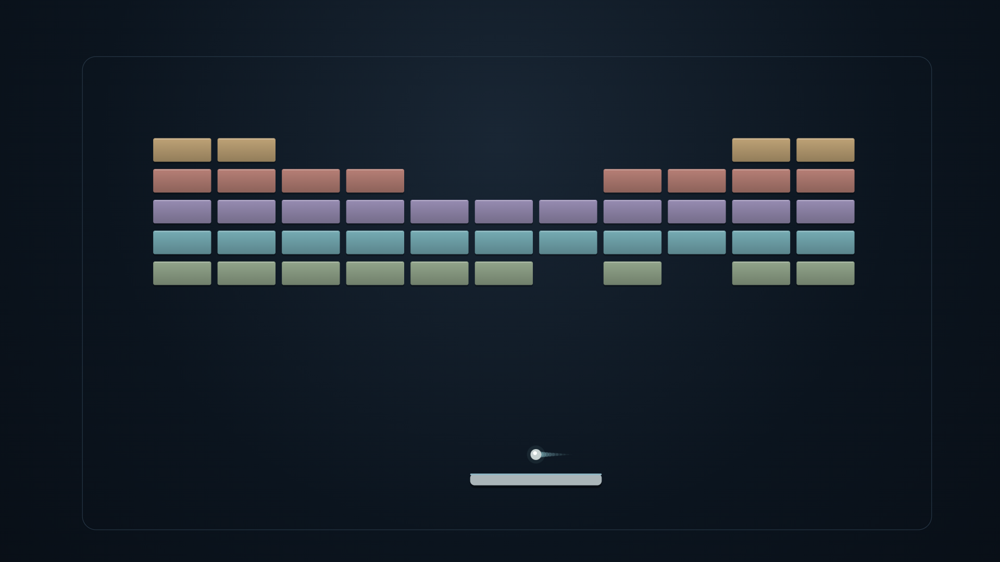

<p align="center">
  <a href="https://github.com/jeremykenedy/lumen-breaker#gh-light-mode-only"><picture><source media="(max-width: 600px) and (prefers-reduced-motion: reduce)" srcset="art/banner-mobile-still-light.6402ceec32b5.svg"><source media="(prefers-reduced-motion: reduce)" srcset="art/banner-still-light.94416f2c7706.svg"><source media="(max-width: 600px)" srcset="art/banner-mobile-light.1453a5933f0e.svg"></picture></a>
  <a href="https://github.com/jeremykenedy/lumen-breaker#gh-dark-mode-only"><picture><source media="(max-width: 600px) and (prefers-reduced-motion: reduce)" srcset="art/banner-mobile-still-dark.4f71cf90b95a.svg"><source media="(prefers-reduced-motion: reduce)" srcset="art/banner-still-dark.7fbe50ea5e44.svg"><source media="(max-width: 600px)" srcset="art/banner-mobile-dark.225d0a740602.svg"></picture></a>
</p>

<p align="center">An offline autonomous brick-breaker screensaver with ceramic formations, luminous motion and real collisions.</p>

<p align="center"><a href="https://github.com/jeremykenedy/lumen-breaker/releases/latest"></a> <a href="https://github.com/jeremykenedy/lumen-breaker/actions/workflows/ci.yml"></a> <a href="LICENSE"></a></p>
<p align="center"><a href="https://github.com/jeremykenedy"></a> <a href="https://github.com/jeremykenedy/lumen-breaker"></a> <a href="https://github.com/sponsors/jeremykenedy"></a></p>




## Table of contents

- [Features](#features)
- [Requirements](#requirements)
- [Install](#install)
- [Fire TV Toolkit](#fire-tv-toolkit)
- [Device verification](#device-verification)
- [Documentation](#documentation)
- [License](#license)

## Features

| Feature | What you get | Guide |
| --- | --- | --- |
| Continuous play | Real brick contacts, limited paddle travel, misses and fresh rounds | [Gameplay](docs/architecture.md) |
| Ceramic formations | Four authored families with restrained light and moving ball trails | [Gallery](docs/screenshots.md) |
| Eight visual choices | Speed, palette, formation, density, ball count, effects, lighting and drift | [Configuration](docs/configuration.md) |
| Remote controls | Readable D-pad settings, fullscreen Preview and persistent options | [Controls](docs/configuration.md) |
| Offline runtime | No ads, tracking, analytics, permissions or network access | [Privacy](docs/privacy.md) |

## Requirements

Android 6.0/API 23 or later with DreamService support, a TV remote and permission to install APKs. This minimum is a build declaration; see the actual device matrix. The standalone installer needs Python 3.10+ and Android Platform Tools on a computer. Fire OS may need a compatible picker because stock Settings can hide third-party dreams.

## Install

[Download the signed APK](https://github.com/jeremykenedy/lumen-breaker/releases/latest/download/lumen-breaker.apk), or use the guided installer:

```sh
git clone https://github.com/jeremykenedy/lumen-breaker.git
cd lumen-breaker
python3 install.py --serial YOUR_TV_IP:5555
```

Open Lumen Breaker from your apps for settings and Preview. Installing does not select it or change TV timers. Select it separately using a supported picker. [Installation, update and removal](docs/installation.md).

## Fire TV Toolkit

[Fire TV Toolkit](https://github.com/jeremykenedy/fire-tv-toolkit) provides guided installation, launcher choices, screensaver selection and supported timer/protection controls. Set it up first:

```sh
git clone https://github.com/jeremykenedy/fire-tv-toolkit.git
cd fire-tv-toolkit
node setup.js
```

Lumen registration is pending its published signed release. After registration, install/select/update/remove use these verified Toolkit command forms:

```sh
firetv-screensavers --install=lumen-breaker
screensaver --set=lumen-breaker
firetv-screensavers --install=lumen-breaker
firetv-screensavers --uninstall=lumen-breaker --yes --force
```

Repeated installation updates. Select another saver before removal. Fire TV UI discovers installed dreams and can open native settings; it does not provide a generic editor for these eight choices. [Integration contract](docs/integrations.md).

## Device verification

| Target | Tested | Limits |
| --- | --- | --- |
| Physical Amazon AFTDEC012E, Android 11/API 30,1920x 1080 | Runtime code 2 Preview, controls, pause/resume and ordinary five-minute idle Dream | Bounded approximately 60 FPS clean samples; no thermal, reboot or other-model claim |
| Google TV emulator, Android 14/API 34,1920x 1080 | Code 3 signed upgrade, native Preview/settings and app-provided picker thumbnail; code 2 lifecycle/controls | Does not establish vendor idle behavior |
| Other Fire TV/Android TV/Google TV | Untested | Volunteers needed; report model, OS/API, resolution and results through the repository issue tracker |

The scene uses the actual native View size. Native 4K, API 28 hardware and every-device compatibility are unverified. [Measurements and limitations](docs/verification.md).

## Documentation

Start with the [documentation index](docs/index.md), [configuration](docs/configuration.md), [native gallery](docs/screenshots.md) or [build instructions](docs/building.md).

Show some love by [starring this repository on GitHub](https://github.com/jeremykenedy/lumen-breaker).

## License

This project is open-sourced software licensed under the [Apache License 2.0](LICENSE). Required notices are in [NOTICE](NOTICE) and bundled in the APK.
