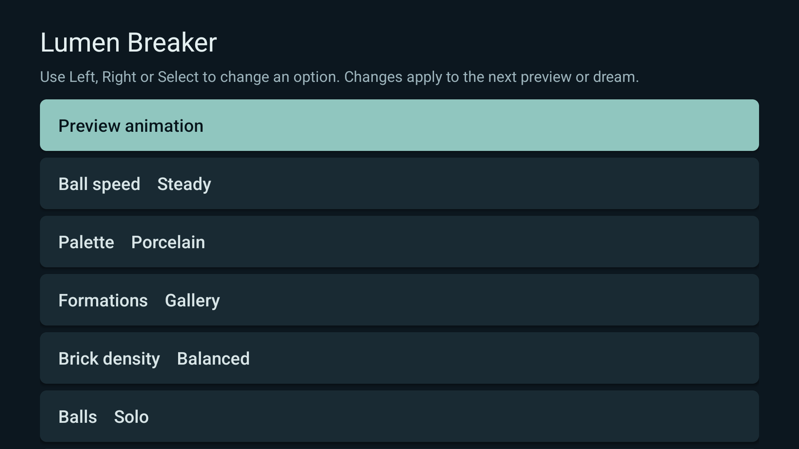
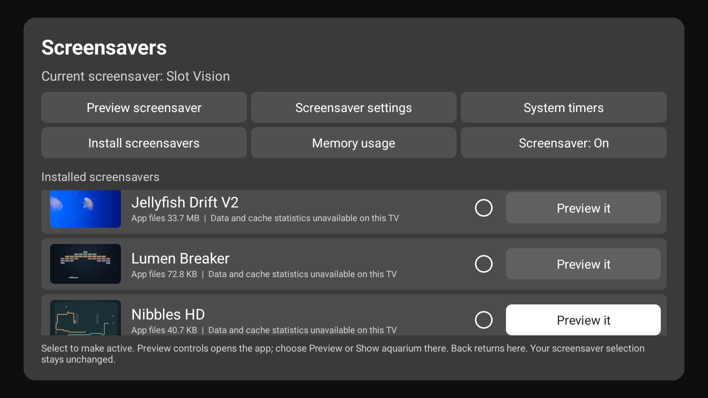
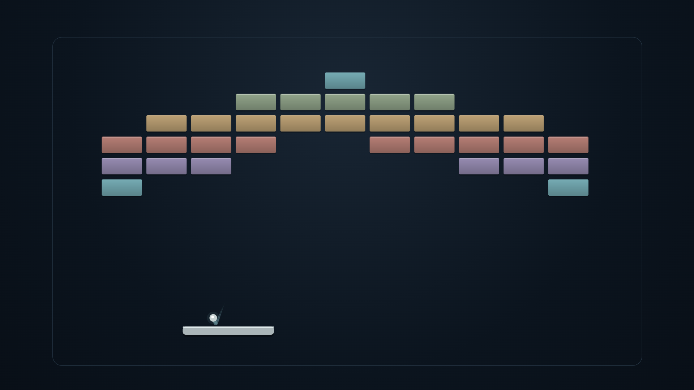
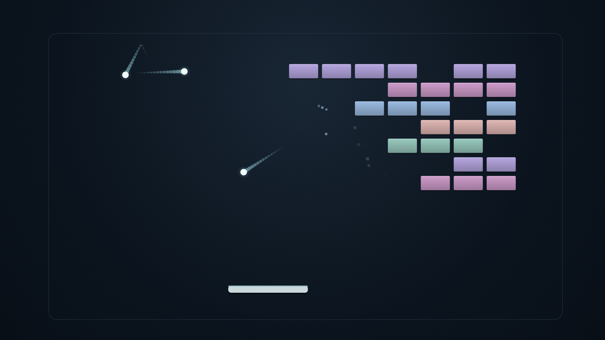
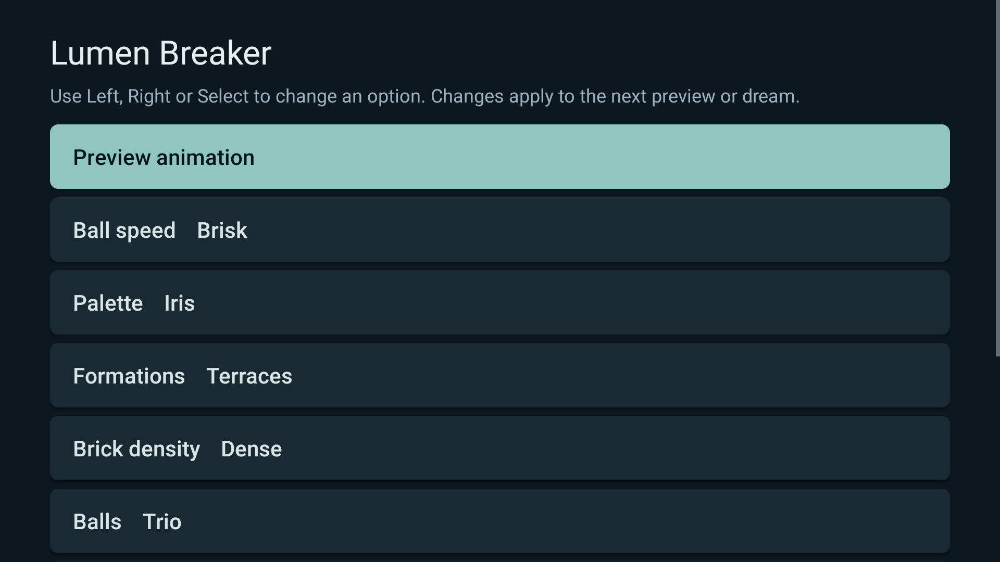

# Native screenshots

## Release package

These unchanged 1920x1080 captures show the final signed1.0.0/code 3 APK on an
Android 14/API 34 Google TV emulator. The Preview is the actual native renderer,
not a browser simulation. The UI 69 picker uses the app-provided metadata image;
no Select action or Dream-selection change was made. Each capture was opened
and visually inspected. [Hashes and provenance](../art/screenshots/provenance.json).

<table><tr><td></td><td></td><td></td></tr></table>

## Physical runtime evidence

The following physical Amazon AFTDEC012E Android 11/API 30 captures retain their
original code 2 provenance. All seven runtime Java files and compiled game classes
are unchanged in code 3; packaging adds the metadata preview. These physical
images are runtime evidence, not new code 3 device captures. The actual normal
idle Dream and default/maximum-load recordings were independently reviewed.

<table><tr><td></td><td></td><td></td></tr></table>
